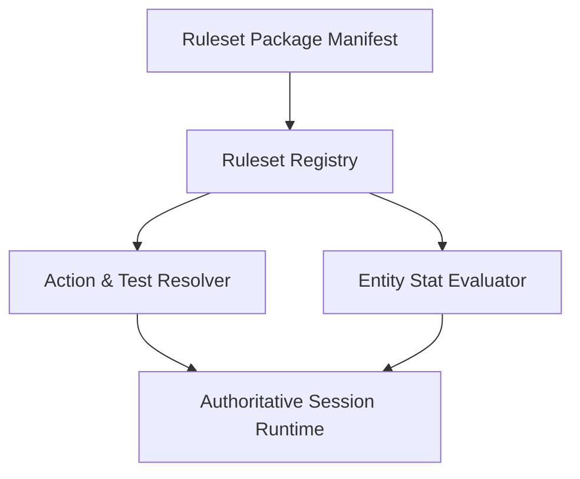
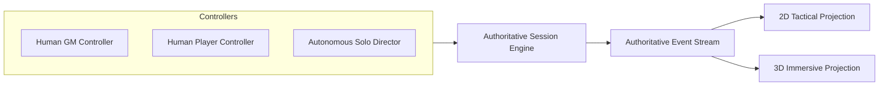

# Design

## Context

The platform builds directly upon the architecture completed by Copilot in `openspec/changes/build-dnd35-character-platform` and documented in `docs/architecture/`:
- [Module Boundaries](file:///Users/vision/Documents/src/experiment/docs/architecture/module-boundaries.md): Strict separation between `domain/`, `rules/`, `character/`, `campaign/`, `session/`, `assets/`, and `clients/`.
- [Shared Conventions](file:///Users/vision/Documents/src/experiment/docs/architecture/shared-conventions.md): Stable opaque string identifiers, provenance tracking, structured validation errors, and deterministic serialization.
- [Hybrid Persistence](file:///Users/vision/Documents/src/experiment/docs/architecture/hybrid-persistence.md): Local durable profile storage + authoritative session service with idempotency keys and ordered event streams.
- [Client Runtime Spike](file:///Users/vision/Documents/src/experiment/docs/architecture/client-runtime-spike.md): Authoritative Python session model projecting onto Unity WebGL 2D tactical and 3D immersive views.

The existing 43 test suite checks (`tests/run_all.py`) establish the baseline regression contract. To fulfill the vision of a universal TTRPG board capable of running diverse systems (such as D&D d20 systems and Warhammer 40k Dark Heresy d100 roll-under systems), the architecture must evolve from system-specific mechanics into an extensible, rules-injected platform while preserving all existing module boundary and persistence invariants.

This requires five interlocking architectural subsystems:
1. An injected rules and behavior engine that decouples dice mechanics, test resolution, and stat schemas from core board state.
2. A quest ingestion pipeline (`quest/`) that transforms narrative scenario text into tactical tiles, environments, NPCs, and encounter triggers.
3. An authoritative session runtime supporting both multi-user collaboration (GM + players) and single-player solo play driven by an autonomous AI director.
4. A ruleset-adaptive character builder pairing mechanical validation with visual customization (portraits, 3D models, cosmetics).
5. An event-driven multimedia presentation pipeline coordinating animations, directional sound, and particle FX across 2D tactical and 3D immersive views.

## Goals / Non-Goals

**Goals:**

- Build a pluggable ruleset engine supporting heterogeneous resolution paradigms (d20 roll-high vs d100 roll-under with degrees of success, dice pools, and custom formulas).
- Design a modular quest ingestion architecture translating natural language or structured adventure text into intermediate scene manifests and rendered board tiles.
- Provide a unified session runtime where solo play and multi-user multiplayer share identical authoritative rules execution and permission models.
- Support deep character customization with ruleset-enforced prerequisites and decoupled presentation profiles (models, textures, portraits, cosmetics).
- Define a reactive audiovisual presentation layer in both Python projection models and Unity WebGL client scripts mapping session events to animations, sound effects, and visual particle FX.

**Non-Goals:**

- Shipping exhaustive content libraries for every commercial TTRPG in existence; instead, deliver a robust schema, D&D 3.5 core, and a Warhammer 40k Dark Heresy starter package as proof of versatility.
- Real-time physics simulation in the 3D client; tactical movement and interaction remain discrete and grid/hex-based.
- Mandatory external cloud AI dependency for quest ingestion; provide a local rule-based/regex/grammar parser with optional LLM hook adapters.

## Decisions

### 1. Injected Rules & Behavior Architecture (Declarative Manifests + Pluggable Resolvers)

Separate game logic into declarative ruleset packages containing:
- **Mechanics Definition**: Dice models (`d20_roll_high`, `d100_roll_under`, `dice_pool`), critical thresholds, degree-of-success formulas.
- **Entity Schema**: Characteristic definitions, derived attributes (HP, AC vs Wounds, Fatigue, Insanity, Fate Points), and inventory slot rules.
- **Action Pipelines**: Step-by-step action resolution chains (e.g. Dark Heresy: Ballistic Test -> Degree of Success Calculation -> Hit Location Roll -> Damage vs Armor & Toughness -> Critical Effect).
- **Sandboxed Hooks**: Expression and script hooks for unusual talents, conditions, and psychic phenomena.

*Alternatives considered:*
- Hardcoded system classes in Python: Inflexible, requires code refactoring for each new game system.
- Unrestricted script execution: Poses security hazards and prevents cross-platform determinism.

### 2. Multi-Pass Quest Ingestion Engine (Text -> Scene Manifest -> Board Synthesis)

Implement a two-stage quest ingestion pipeline:
1. **Parser / Extractor**: Reads narrative text quests (Markdown, YAML, or plain text adventure modules) and extracts rooms, terrain descriptions, monster/NPC encounters, loot, and hazards into an **Intermediate Scene Manifest (ISM)**.
2. **Board Synthesizer**: Consumes the ISM to generate:
   - Tile grid topology (floors, obstacles, doors, elevation, lighting).
   - Entity placements (NPC monsters, neutral characters, and party entry anchors).
   - Encounter trigger zones (traps, perception triggers, ambush boundaries).

*Alternatives considered:*
- Direct generation to board tiles: Brittle and uninspectable; GMs cannot preview, edit, or adjust generated encounters before loading them onto the active board.

### 3. Dual Controller Architecture (Multi-User Collaboration & Autonomous Solo Director)

The session engine treats all participants as `Controller` instances:
- **Multi-User Mode**: Human GM controllers have omniscient visibility and administrative rights; connected player controllers have vision restricted by fog-of-war and ownership limited to their respective characters.
- **Single-Player Solo Mode**: An `AutonomousDirectorController` takes the GM role. It evaluates narrative queries via a solo oracle system (interpreting probability, twists, and scene pacing) and drives reactive NPC tactical behaviors using utility-based decision trees during combat encounters.

*Alternatives considered:*
- Distinct game engines for solo vs multiplayer: Violates DRY and introduces divergence between solo rules testing and group campaigns.

### 4. Dynamic Ruleset-Adaptive Character Builder

The builder does not hardcode forms. Instead, it reads the active ruleset's `creation_schema`:
- Dynamically sequences steps: e.g. D&D (Stats -> Race -> Class -> Skills -> Feats -> Gear) vs Dark Heresy (Homeworld -> Career -> Characteristics -> Divination -> Skills & Talents -> Gear).
- Validates choices against injected prerequisites and point pools.
- Saves a separate `PresentationProfile` containing 2D portrait links, top-down token configs, 3D rig references, texture tints, and cosmetic item slots.

### 5. Event-Driven Multimedia Presentation Pipeline

Gameplay actions emit strongly typed events (`EntityMoved`, `TestResolved`, `AttackLanded`, `DamageApplied`, `SpellDetonated`, `EntityIncapacitated`).
The presentation layer in clients (including `UnityClient`) contains a `PresentationRegistry` that binds:
- Event types + Ruleset tags -> Animation trigger (e.g. `MeleeSwing`, `CastSpell`, `Recoil`, `Die`).
- Event types + Weapon/Spell IDs -> Sound effects (audio clips with 3D spatial attenuation and environmental reverb).
- Event types + Coordinates -> Particle Systems and visual shader effects (magic runes, explosions, blood splatter, bullet tracers).
- Fallback system ensures missing custom assets smoothly degrade to standard archetype visuals and default audio cues without errors.

## Risks / Trade-offs

- **[Risk: Complex ruleset mechanics divergence (e.g., Dark Heresy hit locations and degrees of success vs D&D d20 saves)]**  
  → *Mitigation*: Design the resolution pipeline as a chain of composable resolution stages (`RollStage`, `ThresholdStage`, `MitigationStage`, `ConsequenceStage`) parameterized by ruleset definitions.

- **[Risk: Ambiguous text quest descriptions resulting in poorly generated board layouts]**  
  → *Mitigation*: Enforce a strict intermediate scene schema with default fallback room geometries and provide a preview/edit mode for GMs and solo players before board instantiation.

- **[Risk: Performance and memory overhead of multimedia assets (3D models, sound clips, particles) in WebGL]**  
  → *Mitigation*: Asset streaming with lazy loading, unified texture atlases, and lightweight archetype fallback assets.

## Migration Plan

1. Upgrade existing `rules/` package resolver and evaluator to handle generalized dice expressions and multi-system rules packages.
2. Introduce `content/dark-heresy-core` alongside `content/dnd35-core` to demonstrate seamless rules injection.
3. Enhance `session/runtime.py` with multi-controller permission checks, fog-of-war spatial queries, and the solo AI Director engine.
4. Implement `quest/` ingestion modules for text scenario parsing.
5. Upgrade `clients/projections.py` and `UnityClient` scripts to propagate multimedia presentation cues (animation, sound, VFX).
6. Verify backward compatibility: ensure existing D&D 3.5 character and session tests pass unmodified.
